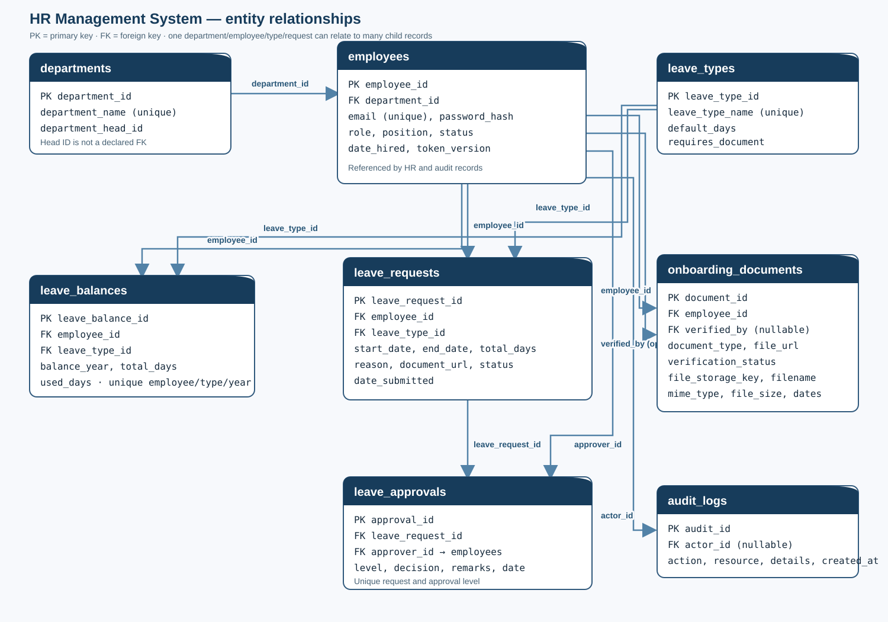

# Employee Onboarding and Leave Management System

> Submission draft: complete the cover fields and add genuine evidence and the shareable video link before final submission.

## Cover Page

**Course:** ITEC 116 — IT Elective 4 (Systems Integration and Architecture 2)<br>
**Project type:** Individual final project<br>
**Student:** Justine Tumampil<br>
**Section:** Add/confirm section<br>
**Instructor:** Add instructor name<br>
**GitHub repository:** [HR-Management-System](https://github.com/TumampilJusitneBSIT2E/HR-Management-System)<br>
**Video walkthrough:** Add the shareable 5–10 minute video URL before final submission<br>
**Presentation date:** November 28, 2026

## Table of Contents

1. Project Overview
2. System Analysis
3. System Architecture
4. Database Design
5. REST API Design
6. Authentication and Security
7. Backend Implementation
8. API Testing and Validation
9. Conclusion
10. References
11. Appendix

## 1. Project Overview

The HR Management System is a full-stack prototype for employee onboarding and leave administration. It supports employees, department heads, and HR managers through role-specific access.

### Objectives

- Store HR data in a relational MySQL database.
- Provide REST endpoints for HR resources.
- Authenticate users with JWT and restrict protected routes.
- Support employee management, leave requests and approvals, and onboarding documents.
- Validate API input and record security-sensitive actions.

### Users and major features

| User | Main tasks |
|---|---|
| Employee | View leave balances, submit and track leave, manage documents, change password |
| Department Head | Review assigned department leave requests and make approval decisions |
| HR Manager | Manage employees, review documents, and complete assigned approvals |

## 2. System Analysis

### Problem

Manual HR processes make it difficult to track leave balances, prevent overlapping requests, assign approvals, and verify onboarding documents consistently.

### Scope

The prototype manages employees and departments, leave types and balances, leave requests and approval records, onboarding documents, and audit events. It uses weekday-based leave duration; public holidays are not excluded.

### Project constraints

- The API uses `/hr/...` and `/auth/...` routes rather than a `/api/v1` prefix.
- Document uploads are stored in a private local upload directory configured by `UPLOAD_DIR`; the application does not integrate with Google Drive. Older `drive://` seed values are demonstration metadata only, not working cloud files.
- The system is designed as a local coursework demonstration using XAMPP/MySQL. It does not include production hosting, cloud storage credentials, or public-holiday calendars.

### Functional requirements

- Authenticate users and protect HR routes.
- Enforce role and ownership checks.
- Create, read, update, and safely deactivate employee records.
- Create, read, update, and delete pending leave requests.
- Validate leave balances, supporting documents, and overlapping dates.
- Record multi-step approval decisions.
- Upload and verify onboarding documents.

## 3. System Architecture

```text
React browser / Postman
          |
          | HTTP + JWT (Bearer token for API clients;
          | HttpOnly cookie for the browser session)
          v
NestJS guards -> DTO validation -> Controller
                                  |
                                  v
                              Service
                                  |
                                  v
                         TypeORM Repository
                         Entity / relations
                                  |
                                  v
                               MySQL
```

Employee and leave-request CRUD, authentication, and HR resource access use TypeORM entities and repositories. Database initialization and a few aggregate/reservation queries use parameterized SQL through TypeORM's `DataSource`. Uploaded document bytes are stored in the private upload directory; the database stores metadata and a storage key.

The route prefixes are `/hr` and `/auth`; there is no `/api/v1` prefix in this implementation. File uploads use a private local directory rather than Google Drive. These choices keep the coursework demo self-contained and avoid requiring cloud credentials or an external upload service; they are implementation differences from earlier lab design ideas, not features that should be described as implemented.

## 4. Database Design

### ERD relationships

The diagram labels primary keys (PK), foreign keys (FK), and the main one-to-many relationships. Department heads and approval actors are employees; document verifiers are optional employees.



### Main entities

| Entity/table | Purpose | Important keys/relationships |
|---|---|---|
| Department | Department directory and assigned head | `department_id` PK; employee collection |
| Employee | User identity, role, and employment status | `employee_id` PK; unique email; department FK |
| LeaveType | Leave categories and policy defaults | `leave_type_id` PK |
| LeaveBalance | Annual entitlement and used days | Employee and leave-type FKs; unique employee/type/year |
| LeaveRequest | Employee leave application | Employee and leave-type FKs |
| LeaveApproval | Ordered approval decisions | Request and approver FKs; unique request/level |
| OnboardingDocument | Document metadata and verification | Employee and verifier FKs |
| AuditLog | Security and HR action history | Optional actor FK |

The TypeORM mappings are in `backend/src/database/entities.ts`. The reproducible DDL is in `docs/hr_system.sql`; backend startup creates missing tables and inserts demonstration records.

## 5. REST API Design

Base URL: `http://localhost:3001`. The system exposes 27 route handlers: 1 root route, 4 authentication routes, and 22 HR routes (including health). Protected endpoints accept an `Authorization: Bearer <JWT>` header or the browser's HttpOnly session cookie. State-changing requests from Postman must include an allowed `Origin` header, normally `http://localhost:5173`.

The method breakdown is 13 GET, 7 POST, 4 PATCH, 1 PUT, and 2 DELETE routes.

| Method | Endpoint | Access | Purpose | Success / common error responses |
|---|---|---|---|---|
| GET | `/` | Public | API greeting | 200; 500 |
| GET | `/hr/health` | Public | Health status | 200; 500 |
| POST | `/auth/login` | Public | Authenticate; returns JWT and sets session cookie | 201; 400, 401, 429 |
| GET | `/auth/me` | Signed in | Read current profile | 200; 401 |
| POST | `/auth/change-password` | Signed in | Change password and rotate JWT | 201; 400, 401, 409 |
| POST | `/auth/logout` | Public | Clear browser session cookie | 201; 403 (invalid Origin) |
| GET | `/hr/employees` | HR Manager | List employees | 200; 401, 403 |
| GET | `/hr/employees/:employeeId` | HR Manager | Read employee | 200; 401, 403, 404 |
| POST | `/hr/employees` | HR Manager | Create employee and initial balances | 201; 400, 401, 403, 404, 409 |
| PATCH | `/hr/employees/:employeeId` | HR Manager | Update employee fields | 200; 400, 401, 403, 404, 409 |
| DELETE | `/hr/employees/:employeeId` | HR Manager | Deactivate employee while retaining HR history | 200; 401, 403, 404, 409 |
| PATCH | `/hr/employees/:employeeId/deactivate` | HR Manager | Legacy deactivate action | 200; 401, 403, 404, 409 |
| POST | `/hr/employees/:employeeId/password-reset` | HR Manager | Issue a temporary password | 201; 401, 403, 404 |
| GET | `/hr/departments` | Signed in | List departments | 200; 401 |
| GET | `/hr/leave-types` | Signed in | List leave types | 200; 401 |
| GET | `/hr/leave-balances` | Signed in; HR sees all | Read annual balances and pending reservations | 200; 401 |
| GET | `/hr/leave-requests` | Signed in | List requests within the user's access scope | 200; 401 |
| GET | `/hr/leave-requests/:requestId` | Signed in | Read an accessible request | 200; 401, 404 |
| POST | `/hr/leave-requests` | Signed in | Submit a leave request | 201; 400, 401, 404, 409 |
| PATCH | `/hr/leave-requests/:requestId` | Owner | Update a pending request | 200; 400, 401, 404, 409 |
| DELETE | `/hr/leave-requests/:requestId` | Owner | Delete a pending request and its pending approval records | 200; 401, 404, 409 |
| GET | `/hr/approvals` | Signed in | List approvals assigned to or submitted by the user | 200; 401 |
| PUT | `/hr/approvals/:approvalId` | Department Head / HR Manager | Approve or reject an assigned approval | 200; 400, 401, 403, 404, 409 |
| GET | `/hr/documents` | Signed in | List documents in the user's access scope | 200; 401 |
| POST | `/hr/documents` | Signed in | Upload a PDF, JPEG, or PNG | 201; 400, 401, 413 |
| GET | `/hr/documents/:documentId/download` | Owner / authorized reviewer / HR | Download a private upload | 200; 401, 404 |
| PATCH | `/hr/documents/:documentId/verification` | HR Manager | Verify or reject a pending document | 200; 400, 401, 403, 404 |

These are expected success codes from NestJS defaults and common errors based on guards, validation, and service checks; they are not a claim that every route/error combination has been individually exercised. `POST` handlers default to `201`; other methods default to `200`. The `Origin` guard can reject state-changing requests whose Origin is not allowed.

The employee and leave-request resources have full CRUD operations. `DELETE` on an employee intentionally deactivates the account rather than erasing records referenced by HR history. Leave-request deletion is limited to the submitting employee and pending requests.

### Example request and response

**Create employee**

```http
POST /hr/employees
Authorization: Bearer <JWT>
Origin: http://localhost:5173
Content-Type: application/json
```

```json
{
  "DepartmentID": 2,
  "FirstName": "Demo",
  "LastName": "Employee",
  "Email": "demo.employee@example.test",
  "Role": "Employee",
  "Position": "Analyst",
  "InitialPassword": "<INITIAL_PASSWORD>"
}
```

Successful creation returns `201 Created` with the employee's public fields; it never returns the password hash. Validation errors return `400`; unauthenticated requests return `401`; role failures return `403`; missing records return `404`; conflicting operations return `409`.

Illustrative successful response (`201 Created`):

```json
{
  "EmployeeID": 42,
  "DepartmentID": 2,
  "FirstName": "Demo",
  "LastName": "Employee",
  "Email": "demo.employee@example.test",
  "Role": "Employee",
  "Position": "Analyst",
  "DateHired": "2026-11-26",
  "EmploymentStatus": "Active"
}
```

### Additional request and response examples

The following are sanitized, illustrative examples based on the DTOs and response mappings. They are documentation examples, not captured Postman evidence. Never publish a live password or JWT; redact tokens in screenshots.

**Login**

```http
POST /auth/login
Origin: http://localhost:5173
Content-Type: application/json
```

```json
{
  "email": "demo.employee@example.test",
  "password": "<PRIVATE_PASSWORD>"
}
```

Successful response (`201 Created`; token intentionally redacted):

```json
{
  "accessToken": "<JWT_REDACTED>",
  "user": {
    "EmployeeID": 42,
    "DepartmentID": 2,
    "FirstName": "Demo",
    "LastName": "Employee",
    "Email": "demo.employee@example.test",
    "Role": "Employee",
    "Position": "Analyst",
    "DateHired": "2026-11-26",
    "EmploymentStatus": "Active",
    "MustChangePassword": false
  }
}
```

**Create leave request**

```http
POST /hr/leave-requests
Authorization: Bearer <JWT>
Origin: http://localhost:5173
Content-Type: application/json
```

```json
{
  "LeaveTypeID": 1,
  "StartDate": "2026-12-01",
  "EndDate": "2026-12-02",
  "Reason": "Example personal leave"
}
```

Illustrative successful response (`201 Created`):

```json
{
  "LeaveRequestID": 101,
  "EmployeeID": 42,
  "LeaveTypeID": 1,
  "StartDate": "2026-12-01",
  "EndDate": "2026-12-02",
  "TotalDays": 2,
  "Reason": "Example personal leave",
  "DocumentURL": null,
  "Status": "Pending",
  "DateSubmitted": "2026-11-26"
}
```

**Unauthenticated request**

```http
GET /hr/employees
```

Illustrative response when no valid Bearer token or session cookie is supplied (`401 Unauthorized`):

```json
{
  "statusCode": 401,
  "message": "Unauthorized"
}
```

## 6. Authentication and Security

- Passwords are hashed with bcrypt; the database stores hashes, not plaintext passwords.
- Initial demonstration-account passwords are supplied through private environment variables, never hard-coded or committed.
- Login issues a short-lived signed JWT. It is returned in the JSON response for API clients and also set as an HttpOnly, SameSite cookie for the React client.
- JWT authentication accepts the session cookie or a Bearer token and checks the employee status and token version.
- Global guards enforce authentication, role metadata, and allowed origins for state-changing requests.
- DTO validation rejects invalid fields and unknown properties.
- Login attempts are rate-limited in process memory.
- Password changes and resets rotate the token version and require a change after reset.
- Uploaded files are restricted by file signature, type, and size; downloads require authorization.
- Security-related changes are written to the audit log.

This is a coursework prototype, not a production security certification. A production deployment would also require HTTPS, durable rate-limiting, secrets management, database backups, and a reviewed migration/deployment process.

## 7. Backend Implementation

The backend uses NestJS modules, controllers, services, DTOs, guards, TypeORM entities, and repositories. The main TypeORM entity mappings are in `backend/src/database/entities.ts`; the HR API is in `backend/src/hr/hr.controller.ts` and `backend/src/hr/hr.service.ts`; authentication is in `backend/src/auth`.

The HR application supports employee management, leave balances and approvals, and private onboarding document workflows. The React frontend is an optional presentation layer; the API can be demonstrated independently with Postman.

### Project structure

```text
HR/
├── backend/
│   ├── src/auth/       # Login, JWT strategy, guards, DTOs
│   ├── src/database/   # TypeORM entities and MySQL initialization
│   └── src/hr/         # HR controllers, services, and DTOs
├── frontend/
│   ├── src/            # React application
│   └── scripts/        # Documentation HTML exporter
├── docs/               # Technical docs, ERD, SQL schema, video guide
└── postman/            # API collection
```

### Request flow example

The controller receives the validated DTO and current user identity, then delegates the operation to the service:

```typescript
@Post('employees')
@Roles('HRManager')
createEmployee(@Body() dto: CreateEmployeeDto, @Req() request: AuthenticatedRequest) {
  return this.hrService.createEmployee(dto, request.user.EmployeeID);
}
```

The service hashes the initial password, opens a transaction, and persists the employee through a TypeORM repository:

```typescript
const passwordHash = await hash(dto.InitialPassword, 10);
return this.employeeRepository.manager.transaction(async (manager) => {
  const employees = manager.getRepository(EmployeeEntity);
  const employee = await employees.save(employees.create({
    departmentId: dto.DepartmentID,
    email: dto.Email.trim().toLowerCase(),
    passwordHash,
    role: dto.Role,
    position: dto.Position.trim(),
    // Other validated employee fields are mapped here.
  }));
  return this.toEmployee(employee);
});
```

The actual implementation also checks the department and duplicate email, creates initial leave balances, and writes an audit entry within the transaction.

### Local setup

1. Start MySQL in XAMPP and create the `hr_system` database if it does not exist. Apache is optional unless using phpMyAdmin.
2. Copy `backend/.env.example` to `backend/.env` and set local connection values and a private JWT secret. Do not commit `.env`.
3. In PowerShell, run `cd D:\xampp\htdocs\HR\backend`, then `npm.cmd install` if dependencies are not installed.
4. Start the API with `npm.cmd run start:dev`; it listens on port `3001`.
5. To run the UI in a second terminal, run `cd D:\xampp\htdocs\HR\frontend`, then `npm.cmd install` if needed and `npm.cmd run dev -- --host 0.0.0.0`. Vite listens on port `5173`.

The backend reads configuration from environment variables: `DB_HOST`, `DB_PORT`, `DB_USER`, `DB_PASSWORD`, `DB_NAME`, `JWT_SECRET`, `DEMO_HR_PASSWORD`, `DEMO_EMPLOYEE_PASSWORD`, `DEMO_DEPARTMENT_HEAD_PASSWORD`, `FRONTEND_ORIGINS`, `API_ORIGIN`, and `UPLOAD_DIR`. This document intentionally does not include their private values.

## 8. API Testing and Validation

Import `postman/HR-System.postman_collection.json` into Postman. Set `hrPassword`; if the seeded account requires a first-login change, set `newPassword` and run the change-password request. The collection includes:

- API health check.
- Login and JWT capture.
- Current-profile request using a Bearer token.
- Missing-token check expecting `401`.
- Employee Create, Read, Update, and Delete/deactivate sequence.
- Leave-request examples for an Employee account.

The collection has representative requests, not one request for every route. The endpoint inventory documents the implemented API; do not describe all routes as individually tested unless they have actually been run.

The recorded local validation completed on November 25, 2026:

- Backend TypeScript/Nest build: passed.
- Frontend production build: passed.
- XAMPP/MySQL connection and API health route: verified after startup.
- Postman login: returned `201 Created`.
- Current profile: returned `200 OK`.
- Protected employees route without a token: returned `401`.
- Employee Create, Read, Update, and Deactivate requests: completed successfully in Postman.
- A successful authenticated leave-request submission and document upload were not recorded as tested.

### Evidence to add before final PDF submission

Insert genuine, sanitized screenshots in this section after recording them. Do not use the illustrative JSON examples above as screenshots or expose an actual JWT.

1. **Login evidence:** show request name and successful status; redact the token and hide passwords.
2. **Employee CRUD evidence:** show successful Create, Read, Update, and Deactivate statuses. Use a throwaway demo employee and hide its initial password.
3. **Authentication evidence:** show the missing-auth request returning `401` with the passing test visible.
4. **Database evidence:** show a phpMyAdmin row for the same demo employee after deactivation, with unrelated employee details hidden.
5. **Leave evidence (optional if not tested):** include only if an Employee-account leave request is successfully submitted; otherwise leave it out and do not claim it was tested.

The live database export, if required by the course, must be exported separately from phpMyAdmin after the demo. `docs/hr_system.sql` is reproducible DDL plus sanitized demonstration data, not a dump of the current live database.

## 9. Conclusion

The prototype integrates a MySQL-backed HR workflow, REST APIs, JWT authentication, role-based access, validation, and a React client. The design prioritizes leave policy checks, controlled approval, and protected employee documents. Future work includes broader automated endpoint tests, a formal migration strategy, and public-holiday-aware leave calculation.

One implementation challenge was keeping the browser's HttpOnly cookie session and Postman's Bearer-token flow compatible with the same guarded API. The project uses an explicit origin guard for state-changing requests and documents the required Origin header for Postman. A lesson from the work is to test authorization and representative CRUD paths as well as confirm that routes compile.

## 10. References

- ITEC 116 Final Project Student Guide, provided in the course materials.
- NestJS documentation: https://docs.nestjs.com/
- TypeORM documentation: https://typeorm.io/
- MySQL documentation: https://dev.mysql.com/doc/
- Postman Learning Center: https://learning.postman.com/

## 11. Appendix

### Environment variable names

Configure these names in the ignored local `backend/.env` file. Values are intentionally omitted from this document and must never be included in screenshots or GitHub:

`DB_HOST`, `DB_PORT`, `DB_USER`, `DB_PASSWORD`, `DB_NAME`, `JWT_SECRET`, `DEMO_HR_PASSWORD`, `DEMO_EMPLOYEE_PASSWORD`, `DEMO_DEPARTMENT_HEAD_PASSWORD`, `FRONTEND_ORIGINS`, `API_ORIGIN`, `UPLOAD_DIR`.

### Database deliverables

- `docs/hr_system.sql` — repeatable schema and sanitized demonstration dataset for coursework setup.
- A separate phpMyAdmin export — create this from the actual local database only if required by the course. Review it for private records and password hashes before submission.

### Export checklist

- Replace the cover-page section and instructor placeholders and add the shareable video URL.
- Add the genuine sanitized evidence listed in Section 8.
- Confirm the course reviewer can access the private GitHub repository.
- Regenerate the PDF from this Markdown source after the final edits. Disable print headers/footers so the browser URL and print date are not added.
