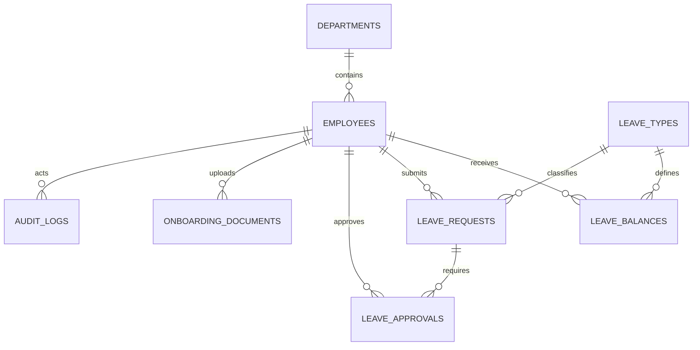

# HR Management System

## Cover Page

**Course:** ITEC 116 — IT Elective 4 (Systems Integration and Architecture 2)  
**Project type:** Individual final project  
**Student:** Justine Tumampil  
**GitHub repository:** [HR-Management-System](https://github.com/TumampilJusitneBSIT2E/HR-Management-System)  
**Video walkthrough:** Add the shareable 5–10 minute video URL before exporting this document  
**Presentation date:** November 28, 2026

## Table of Contents

1. Project Overview
2. System Analysis
3. System Architecture
4. Database Design
5. REST API Design
6. Authentication and Security
7. Backend Implementation
8. API Testing and Validation
9. Conclusion
10. References
11. Appendix

## 1. Project Overview

The HR Management System is a full-stack prototype for employee onboarding and leave administration. It supports employees, department heads, and HR managers through role-specific access.

### Objectives

- Store HR data in a relational MySQL database.
- Provide REST endpoints for HR resources.
- Authenticate users with JWT and restrict protected routes.
- Support employee management, leave requests and approvals, and onboarding documents.
- Validate API input and record security-sensitive actions.

### Users and major features

| User | Main tasks |
|---|---|
| Employee | View leave balances, submit and track leave, manage documents, change password |
| Department Head | Review assigned department leave requests and make approval decisions |
| HR Manager | Manage employees, review documents, and complete assigned approvals |

## 2. System Analysis

### Problem

Manual HR processes make it difficult to track leave balances, prevent overlapping requests, assign approvals, and verify onboarding documents consistently.

### Scope

The prototype manages employees and departments, leave types and balances, leave requests and approval records, onboarding documents, and audit events. It uses weekday-based leave duration; public holidays are not excluded.

### Functional requirements

- Authenticate users and protect HR routes.
- Enforce role and ownership checks.
- Create, read, update, and safely deactivate employee records.
- Create, read, update, and delete pending leave requests.
- Validate leave balances, supporting documents, and overlapping dates.
- Record multi-step approval decisions.
- Upload and verify onboarding documents.

## 3. System Architecture

```text
React browser / Postman
          |
          | HTTP + JWT (Bearer token for API clients;
          | HttpOnly cookie for the browser session)
          v
NestJS guards -> DTO validation -> Controller
                                  |
                                  v
                              Service
                                  |
                                  v
                         TypeORM Repository
                         Entity / relations
                                  |
                                  v
                               MySQL
```

Employee and leave-request CRUD, authentication, and HR resource access use TypeORM entities and repositories. Database initialization and a few aggregate/reservation queries use parameterized SQL through TypeORM's `DataSource`. Uploaded document bytes are stored in the private upload directory; the database stores metadata and a storage key.

## 4. Database Design

### ERD relationships



### Main entities

| Entity/table | Purpose | Important keys/relationships |
|---|---|---|
| Department | Department directory and assigned head | `department_id` PK; employee collection |
| Employee | User identity, role, and employment status | `employee_id` PK; unique email; department FK |
| LeaveType | Leave categories and policy defaults | `leave_type_id` PK |
| LeaveBalance | Annual entitlement and used days | Employee and leave-type FKs; unique employee/type/year |
| LeaveRequest | Employee leave application | Employee and leave-type FKs |
| LeaveApproval | Ordered approval decisions | Request and approver FKs; unique request/level |
| OnboardingDocument | Document metadata and verification | Employee and verifier FKs |
| AuditLog | Security and HR action history | Optional actor FK |

The TypeORM mappings are in `backend/src/database/entities.ts`. The reproducible DDL is in `docs/hr_system.sql`; backend startup creates missing tables and inserts demonstration records.

## 5. REST API Design

Base URL: `http://localhost:3001`. Protected endpoints accept an `Authorization: Bearer <JWT>` header or the browser's HttpOnly session cookie. State-changing requests from Postman must include an allowed `Origin` header, normally `http://localhost:5173`.

| Method | Endpoint | Access | Purpose |
|---|---|---|---|
| GET | `/` | Public | API greeting |
| GET | `/hr/health` | Public | Health status |
| POST | `/auth/login` | Public | Authenticate; returns JWT and sets session cookie |
| GET | `/auth/me` | Signed in | Read current profile |
| POST | `/auth/change-password` | Signed in | Change password and rotate JWT |
| POST | `/auth/logout` | Public | Clear browser session cookie |
| GET | `/hr/employees` | HR Manager | List employees |
| GET | `/hr/employees/:employeeId` | HR Manager | Read employee |
| POST | `/hr/employees` | HR Manager | Create employee and initial balances |
| PATCH | `/hr/employees/:employeeId` | HR Manager | Update employee fields |
| DELETE | `/hr/employees/:employeeId` | HR Manager | Deactivate employee while retaining HR history |
| PATCH | `/hr/employees/:employeeId/deactivate` | HR Manager | Legacy deactivate action |
| POST | `/hr/employees/:employeeId/password-reset` | HR Manager | Issue a temporary password |
| GET | `/hr/departments` | Signed in | List departments |
| GET | `/hr/leave-types` | Signed in | List leave types |
| GET | `/hr/leave-balances` | Signed in; HR sees all | Read annual balances and pending reservations |
| GET | `/hr/leave-requests` | Signed in | List requests within the user's access scope |
| GET | `/hr/leave-requests/:requestId` | Signed in | Read an accessible request |
| POST | `/hr/leave-requests` | Signed in | Submit a leave request |
| PATCH | `/hr/leave-requests/:requestId` | Owner | Update a pending request |
| DELETE | `/hr/leave-requests/:requestId` | Owner | Delete a pending request and its pending approval records |
| GET | `/hr/approvals` | Signed in | List approvals assigned to or submitted by the user |
| PUT | `/hr/approvals/:approvalId` | Department Head / HR Manager | Approve or reject an assigned approval |
| GET | `/hr/documents` | Signed in | List documents in the user's access scope |
| POST | `/hr/documents` | Signed in | Upload a PDF, JPEG, or PNG |
| GET | `/hr/documents/:documentId/download` | Owner / authorized reviewer / HR | Download a private upload |
| PATCH | `/hr/documents/:documentId/verification` | HR Manager | Verify or reject a pending document |

The employee and leave-request resources have full CRUD operations. `DELETE` on an employee intentionally deactivates the account rather than erasing records referenced by HR history. Leave-request deletion is limited to the submitting employee and pending requests.

### Example request and response

**Create employee**

```http
POST /hr/employees
Authorization: Bearer <JWT>
Origin: http://localhost:5173
Content-Type: application/json
```

```json
{
  "DepartmentID": 2,
  "FirstName": "Demo",
  "LastName": "Employee",
  "Email": "demo.employee@example.test",
  "Role": "Employee",
  "Position": "Analyst",
  "InitialPassword": "<INITIAL_PASSWORD>"
}
```

Successful creation returns `201 Created` with the employee's public fields; it never returns the password hash. Validation errors return `400`; unauthenticated requests return `401`; role failures return `403`; missing records return `404`; conflicting operations return `409`.

## 6. Authentication and Security

- Passwords are hashed with bcrypt; the database stores hashes, not plaintext passwords.
- Initial demonstration-account passwords are supplied through private environment variables, never hard-coded or committed.
- Login issues a short-lived signed JWT. It is returned in the JSON response for API clients and also set as an HttpOnly, SameSite cookie for the React client.
- JWT authentication accepts the session cookie or a Bearer token and checks the employee status and token version.
- Global guards enforce authentication, role metadata, and allowed origins for state-changing requests.
- DTO validation rejects invalid fields and unknown properties.
- Login attempts are rate-limited in process memory.
- Password changes and resets rotate the token version and require a change after reset.
- Uploaded files are restricted by file signature, type, and size; downloads require authorization.
- Security-related changes are written to the audit log.

This is a coursework prototype, not a production security certification. A production deployment would also require HTTPS, durable rate-limiting, secrets management, database backups, and a reviewed migration/deployment process.

## 7. Backend Implementation

The backend uses NestJS modules, controllers, services, DTOs, guards, TypeORM entities, and repositories. The main TypeORM entity mappings are in `backend/src/database/entities.ts`; the HR API is in `backend/src/hr/hr.controller.ts` and `backend/src/hr/hr.service.ts`; authentication is in `backend/src/auth`.

The HR application supports employee management, leave balances and approvals, and private onboarding document workflows. The React frontend is an optional presentation layer; the API can be demonstrated independently with Postman.

## 8. API Testing and Validation

Import `postman/HR-System.postman_collection.json` into Postman. Set `hrPassword`; if the seeded account requires a first-login change, set `newPassword` and run the change-password request. The collection includes:

- API health check.
- Login and JWT capture.
- Current-profile request using a Bearer token.
- Missing-token check expecting `401`.
- Employee Create, Read, Update, and Delete/deactivate sequence.
- Leave-request examples for an Employee account.

The current local validation record:

- Backend TypeScript/Nest build: passed.
- Frontend production build: passed.
- XAMPP/MySQL connection and API health route: verified after startup.
- Protected employees route without a token: returned `401`.
- Capture and insert representative Postman screenshots here before final PDF export.

## 9. Conclusion

The prototype integrates a MySQL-backed HR workflow, REST APIs, JWT authentication, role-based access, validation, and a React client. The design prioritizes leave policy checks, controlled approval, and protected employee documents. Future work includes broader automated endpoint tests, a formal migration strategy, and public-holiday-aware leave calculation.

## 10. References

- ITEC 116 Final Project Student Guide, provided in the course materials.
- NestJS documentation: https://docs.nestjs.com/
- TypeORM documentation: https://typeorm.io/
- MySQL documentation: https://dev.mysql.com/doc/
- Postman Learning Center: https://learning.postman.com/

## 11. Submission items still to complete

This local PDF is a documentation draft. Complete these items and export it again before submitting:

1. Add the shareable video URL on the cover and make sure the course reviewer can access the private GitHub repository.
2. Add screenshots of successful Postman tests and a phpMyAdmin record that matches the request.
3. Confirm the ERD and endpoint examples match the final implementation.
4. Export this document to PDF and open the exported file once to verify it.
